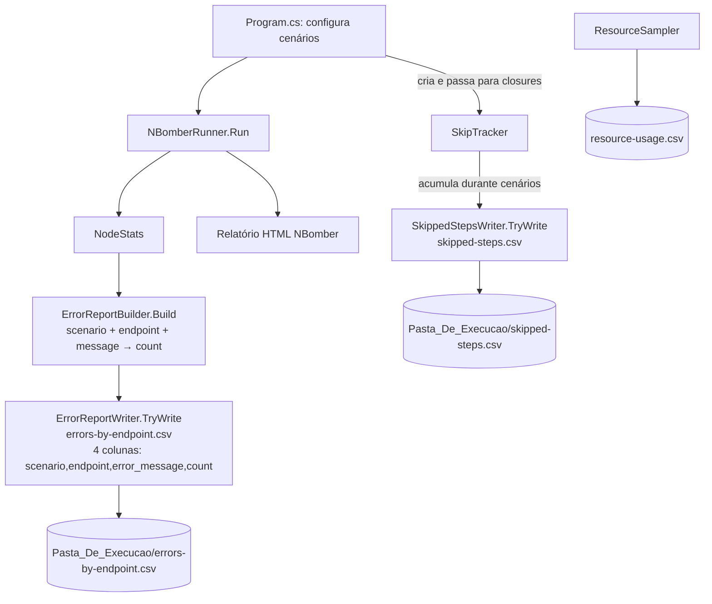

# Design Document

## Overview

Este documento descreve o design das duas melhorias de relatório para
`EbenezerBackend.LoadTests`:

1. **Coluna `scenario` no `errors-by-endpoint.csv`** (Requirement 7): o `StepFailure` passa a
   carregar o nome do cenário; `ErrorReportBuilder`, `ErrorReportWriter` e o CSV atualizam suas
   interfaces para incorporar a coluna e incluí-la na chave de agrupamento e ordenação.

2. **Relatório `skipped-steps.csv`** (Requirements 8, 9): um `SkipTracker` leve é criado em
   `Program.cs` e passado para cada cenário via closure. Cada bloco condicional (`if`) que
   não executa registra os steps pulados no tracker. Ao final do `Run()`, um novo
   `SkippedStepsWriter` grava o arquivo, reutilizando o `CsvWriter` existente.

A estratégia mantém a separação entre lógica pura (sem I/O) e camada de E/S já estabelecida
pelo spec anterior, evitando regressões e mantendo testabilidade.

## Architecture



### Camadas

- **Domínio puro (sem I/O)**:
  - `CsvWriter` — inalterado.
  - `ErrorReportBuilder` — recebe `scenario` via `StepFailure`; header e agrupamento/ordenação atualizados.
  - `SkipTracker` — acumula `SkippedStep` records; sem I/O.
  - `SkippedStepsBuilder` — ordena os `SkippedStep` records para serialização; sem I/O.

- **Camada de E/O**:
  - `ErrorReportWriter` — adaptação mínima para a nova coluna.
  - `SkippedStepsWriter` — novo; mesma estrutura defensiva do `ErrorReportWriter`.

- **Orquestração**: `Program.cs` cria o `SkipTracker`, injeta-o nas closures dos cenários via
  captura lexical, e chama ambos os writers após o `Run()`.

## Components and Interfaces

### 1. `StepFailure` — adição do campo `ScenarioName`

```csharp
public sealed record StepFailure(
    string ScenarioName,  // NOVO — NBomber: ScenarioStats.ScenarioName
    string StepName,
    string? Message,
    string? StatusCode,
    long Count);
```

Impacto: `ErrorReportExtensions.ExtractFailures` passa a incluir `scenario.ScenarioName` ao
construir cada `StepFailure`. Nenhuma outra alteração de interface é necessária aqui.

### 2. `ErrorReportBuilder` — nova coluna e chave de agrupamento

Header atualizado:

```csharp
public static IReadOnlyList<string> Header =>
    new[] { "scenario", "endpoint", "error_message", "count" };
```

Chave de agrupamento: `(scenarioName, endpoint, errorMessage)`.

Ordenação: `scenario` (ordinal asc) → `endpoint` (ordinal asc) → `error_message` (ordinal asc).

`ErrorRow` atualizado:

```csharp
public sealed record ErrorRow(
    string Scenario,
    string Endpoint,
    string ErrorMessage,
    long Count);
```

`ResolveScenario`: análogo a `ResolveEndpoint` — se `ScenarioName` for vazio ou nulo, retorna
`"unknown"` (Req 7.5).

`Build` — assinatura inalterada (`IEnumerable<StepFailure>, ISet<string>? knownEndpoints`);
internamente agora agrupa por `(scenario, endpoint, message)` e ordena por três chaves.

### 3. `SkippedStep` — modelo de dados

```csharp
namespace EbenezerBackend.LoadTests.Reporting;

/// <summary>Um step que não foi executado por uma pré-condição não satisfeita.</summary>
public sealed record SkippedStep(
    string Scenario,   // nome do cenário (ex.: "write_heavy")
    string StepName,   // nome do step que teria sido executado (ex.: "04_update_category")
    string Reason);    // motivo legível (ex.: "categoryId is empty")
```

### 4. `SkipTracker` — acúmulo sem I/O

```csharp
namespace EbenezerBackend.LoadTests.Reporting;

/// <summary>
/// Acumula registros de steps pulados durante a execução dos cenários.
/// Thread-safe via lock simples (múltiplos cenários rodam em paralelo no NBomber).
/// </summary>
public sealed class SkipTracker
{
    private readonly List<SkippedStep> _records = new();
    private readonly object _lock = new();

    /// <summary>Registra um step pulado. Pode ser chamado de qualquer thread.</summary>
    public void Record(string scenario, string stepName, string reason);

    /// <summary>Retorna snapshot imutável de todos os registros acumulados.</summary>
    public IReadOnlyList<SkippedStep> Snapshot();
}
```

`Record` faz `lock(_lock) { _records.Add(...) }`.
`Snapshot` faz `lock(_lock) { return _records.ToList().AsReadOnly() }`.

### 5. `SkippedStepsBuilder` — ordenação pura

```csharp
namespace EbenezerBackend.LoadTests.Reporting;

public static class SkippedStepsBuilder
{
    public static IReadOnlyList<string> Header =>
        new[] { "scenario", "step_name", "reason" };

    /// Ordena os registros: scenario (ordinal asc), step_name (ordinal asc).
    public static IReadOnlyList<SkippedStep> Sort(IEnumerable<SkippedStep> records);
}
```

### 6. `SkippedStepsWriter` — camada de E/O

```csharp
namespace EbenezerBackend.LoadTests.Reporting;

public static class SkippedStepsWriter
{
    public const string FileName = "skipped-steps.csv";

    /// Mesmo contrato defensivo do ErrorReportWriter:
    /// nunca lança, emite aviso no console em caso de falha, retorna bool.
    public static bool TryWrite(string reportFolder,
                                IEnumerable<SkippedStep> records);
}
```

Internamente:
1. `SkippedStepsBuilder.Sort(records)` para ordem determinística.
2. Projeta para `IReadOnlyList<IReadOnlyList<string?>>`.
3. `CsvWriter.Write(SkippedStepsBuilder.Header, rows)`.
4. `File.WriteAllText(path, content, new UTF8Encoding(false))`.
5. `Directory.CreateDirectory(reportFolder)` antes de gravar.
6. Captura qualquer exceção, console warning, retorna `false`.

### 7. `ErrorReportExtensions.ExtractFailures` — passa `ScenarioName`

```csharp
public static IEnumerable<StepFailure> ExtractFailures(NodeStats stats)
{
    foreach (var scenario in stats.ScenarioStats)
        foreach (var step in scenario.StepStats)
            foreach (var sc in step.Fail.StatusCodes)
                if (sc.Count > 0)
                    yield return new StepFailure(
                        scenario.ScenarioName,  // NOVO
                        step.StepName,
                        sc.Message,
                        sc.StatusCode,
                        sc.Count);
}
```

### 8. Integração em `Program.cs`

Antes do `NBomberRunner.RegisterScenarios(...)`:

```csharp
var skipTracker = new SkipTracker();
```

Dentro de cada closure de cenário, cada bloco `if` que não executa registra os steps pulados.
Exemplo do `write_heavy`:

```csharp
// ANTES — steps 04_update_category simplesmente não rodam
if (!string.IsNullOrEmpty(categoryId))
{
    await Step.Run("04_update_category", ...);
}

// DEPOIS — o else registra o pulo
if (!string.IsNullOrEmpty(categoryId))
{
    await Step.Run("04_update_category", ...);
}
else
{
    skipTracker.Record("write_heavy", "04_update_category", "categoryId is empty");
}
```

Para retornos antecipados (`return Response.Fail()` após `s01.IsError`), os steps pulados são
registrados antes do `return`:

```csharp
if (s01.IsError)
{
    skipTracker.Record("write_heavy", "02_register_profile", "s01.IsError = true – registration failed");
    skipTracker.Record("write_heavy", "03_create_category",  "s01.IsError = true – registration failed");
    // ... todos os demais steps do cenário
    return Response.Fail();
}
```

Após o `Run()`:

```csharp
NodeStats stats = NBomberRunner...Run();

ErrorReportWriter.TryWrite(reportFolder, ErrorReportExtensions.ExtractFailures(stats));
SkippedStepsWriter.TryWrite(reportFolder, skipTracker.Snapshot());
```

#### Mapeamento completo de steps condicionais por cenário

**write_heavy**
| Condição | Steps pulados | Motivo |
|----------|---------------|--------|
| `s01.IsError` | 02..11 | `"s01.IsError = true – registration failed"` |
| `categoryId is empty` | `04_update_category`, `11_delete_category` | `"categoryId is empty"` |
| `s05.IsError \|\| prayerId is empty` | 06..10 | `"s05.IsError = true – prayer creation failed"` ou `"prayerId is empty"` |

**read_heavy**
| Condição | Steps pulados | Motivo |
|----------|---------------|--------|
| `s01.IsError` | 02..11 | `"s01.IsError = true – registration failed"` |
| `prayerId is empty` | `04_get_prayer_by_id` | `"prayerId is empty"` |
| `categoryId is empty` | `08_get_category_by_id` | `"categoryId is empty"` |

**graph_heavy**
| Condição | Steps pulados | Motivo |
|----------|---------------|--------|
| `s01.IsError` | 02..14 | `"s01.IsError = true – user A registration failed"` |
| `s02.IsError` | 03..14 | `"s02.IsError = true – user B registration failed"` |
| `s03.IsError \|\| userIdB is empty` | 04..14 | `"s03.IsError = true – profile B not found"` ou `"userIdB is empty"` |
| `s04.IsError \|\| reqId is empty` | 06..10 | `"s04.IsError = true – friend request failed"` ou `"reqId is empty"` |
| `s11.IsError \|\| cancelId is empty` | `12_cancel_request` | `"s11.IsError = true – send-to-cancel failed"` ou `"cancelId is empty"` |
| `s13.IsError \|\| declineId is empty` | `14_decline_request` | `"s13.IsError = true – send-to-decline failed"` ou `"declineId is empty"` |

**document_heavy**
| Condição | Steps pulados | Motivo |
|----------|---------------|--------|
| `s01.IsError` | 02..08 | `"s01.IsError = true – registration failed"` |
| `s03.IsError \|\| prayerId is empty` | `04_get_prayer`, `05_update_prayer` | `"s03.IsError = true – prayer creation failed"` ou `"prayerId is empty"` |
| `categoryId is empty` | `08_get_category` | `"categoryId is empty"` |

**mixed_graph_documents**
| Condição | Steps pulados | Motivo |
|----------|---------------|--------|
| `s01.IsError` | 02..12 | `"s01.IsError = true – user A registration failed"` |
| `s03.IsError` | 04..09 (partes do grafo) | `"s03.IsError = true – user B registration failed"` |
| `userIdB is empty` | `06_send_request`, `07_accept_request`, `09_mutual_friends` | `"userIdB is empty"` |
| `s06.IsError \|\| reqId is empty` | `07_accept_request`, `09_mutual_friends` | `"s06.IsError = true – friend request failed"` ou `"reqId is empty"` |
| `s05.IsError \|\| prayerId is empty` | `11_add_comment` | `"s05.IsError = true – prayer creation failed"` ou `"prayerId is empty"` |

## Data Models

### `SkippedStep`
| Campo    | Tipo   | Coluna CSV  |
|----------|--------|-------------|
| Scenario | string | `scenario`  |
| StepName | string | `step_name` |
| Reason   | string | `reason`    |

### `ErrorRow` (atualizado)
| Campo        | Tipo   | Coluna CSV      |
|--------------|--------|-----------------|
| Scenario     | string | `scenario`      |
| Endpoint     | string | `endpoint`      |
| ErrorMessage | string | `error_message` |
| Count        | long   | `count`         |

## Correctness Properties

### Property 12: Coluna `scenario` na chave de agrupamento

Para toda coleção de `StepFailure` contendo falhas do mesmo step e mensagem provenientes de
cenários distintos, `ErrorReportBuilder.Build` produz linhas separadas para cada cenário,
e o total de linhas reflete o número de pares distintos `(scenario, endpoint, error_message)`.

**Validates: Requirements 7.3**

### Property 13: Ordenação determinística com `scenario`

Para toda coleção de falhas, as linhas produzidas por `ErrorReportBuilder.Build` estão
ordenadas por `scenario` (ordinal asc) → `endpoint` (ordinal asc) → `error_message`
(ordinal asc); qualquer permutação da entrada produz a mesma sequência de saída.

**Validates: Requirement 7.4**

### Property 14: `SkipTracker` é thread-safe e preserva todos os registros

Para toda sequência de chamadas concorrentes a `SkipTracker.Record`, `Snapshot()` retorna
uma lista contendo exatamente todos os registros inseridos, sem perdas nem duplicatas.

**Validates: Requirement 8.3 (integridade em execuções paralelas do NBomber)**

### Property 15: Ordenação determinística do `SkippedStepsBuilder`

Para toda coleção de `SkippedStep`, `SkippedStepsBuilder.Sort` produz a sequência ordenada
por `scenario` (ordinal asc) → `step_name` (ordinal asc); qualquer permutação da entrada
produz a mesma sequência de saída.

**Validates: Requirement 8.6**

### Property 16: Robustez do `SkippedStepsWriter` (nunca lança)

Para toda combinação de pasta de destino e coleção de `SkippedStep`, `SkippedStepsWriter.TryWrite`
retorna um booleano sem propagar exceção.

**Validates: Requirements 8.7**

## Error Handling

| Cenário | Tratamento |
|---------|------------|
| `ScenarioName` nulo/vazio no `StepFailure` | `ResolveScenario` retorna `"unknown"` (Req 7.5) |
| Falha de E/O no `SkippedStepsWriter` | Console warning, retorna `false`, sem propagar (Req 8.7) |
| Nenhum step pulado | Grava CSV apenas com cabeçalho (Req 8.5) |
| `SkipTracker` chamado de threads paralelas | `lock` garante integridade (Req 8.3) |

## Testing Strategy

Herda a estrutura do spec anterior (FsCheck.Xunit + xunit). Adições:

### Testes de propriedade (PBT)
- **Property 12**: gerar `StepFailure` com cenários distintos para o mesmo `(endpoint, message)` e verificar que `Build` produz linhas separadas por cenário.
- **Property 13**: verificar ordenação com três chaves para permutações da entrada.
- **Property 14**: lançar N threads concorrentes chamando `Record` e comparar `Snapshot` com o conjunto esperado.
- **Property 15**: verificar que `Sort` é idempotente e estável para qualquer permutação.
- **Property 16**: pastas inválidas/inacessíveis nunca fazem `TryWrite` propagar exceção.

### Testes de exemplo (Fact/Theory)
- Cabeçalho do `errors-by-endpoint.csv` agora é `scenario,endpoint,error_message,count`.
- Cabeçalho do `skipped-steps.csv` é `scenario,step_name,reason`.
- `SkippedStepsWriter` grava na pasta correta, cria subpastas, sobrescreve.
- `ExtractFailures` propaga `ScenarioName` corretamente.
- Cenário com nenhum step pulado produz CSV com apenas cabeçalho.
